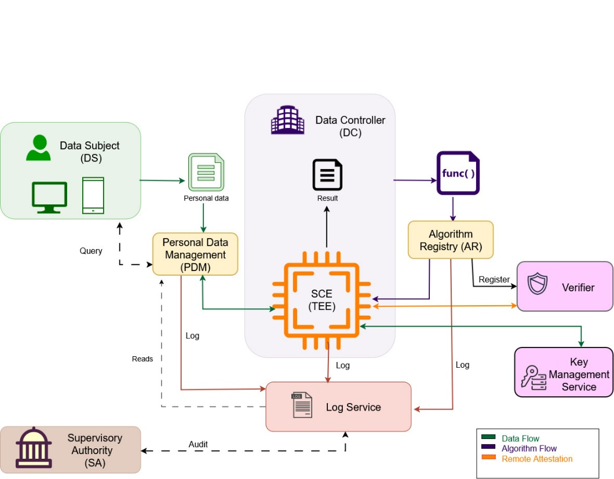

# ST-DP

Research proof of concept of the Secure Computing Environment (SCE) in the Secure and Transparent Data
Processing (ST-DP) architecture on AWS Nitro Enclaves, with the fully trusted RADS baseline included
alongside it for comparison. It accompanies a research paper that is not published yet; citation
details will be added with the publication.

A Data Controller's algorithm runs inside an attested enclave over a data subject's personal data, so
the data is processed without the Data Controller ever seeing it. RADS is the baseline; Secure-RADS
extends it with the security controls required for protected personal-data computation, including
KMS-backed encryption and enclave attestation.

This is not production software. It is published so the design and measurements can be inspected and
reproduced. There is no support commitment and no security guarantee. It is licensed under the
Apache License 2.0; see [License](#license).

## Architecture



ST-DP separates the entity that decides why personal data is processed from the services that hold,
process, and record that processing. Black edges are request and data paths, orange is remote
attestation, and blue is data-key release.

- **Data Subject (DS)** gives consent and personal data, and queries how the data was used.
- **Personal Data Management (PDM)** stores personal data against its consent and algorithm, serves it only to an attested SCE, and answers DS queries by querying the Log Service.
- **Algorithm Registry (AR)** holds algorithms that were vetted and validated against a consent, and registers their measurements with the Verifier. In this PoC, registry-service performs the registration; algorithm vetting and consent approval are out of scope.
- **Verifier** stores the expected measurements per algorithm and issues a signed, time-constrained token to an SCE that attests correctly.
- **Key Management Service (KMS)** releases the data-encryption key only to an SCE holding a valid verifier token.
- **Log Service** holds the data-subject access trail that supports DS and Supervisory Authority queries.
- **Telemetry Service** holds the best-effort build and run timeline used for performance, debugging, and benchmark exports.
- **Secure Computing Environment (SCE)** fetches encrypted records, decrypts them, runs the DC's algorithm inside the enclave, and records the run with the Log Service.

This repo implements the SCE and the supporting services needed to run and inspect it. Consent capture,
algorithm vetting, and consent-to-algorithm validation are not implemented. The Supervisory Authority
role is served by the transparency portal's authority view, a read-only dashboard rather than a separate
service.

## rads (baseline)

[`rads/`](rads/) is the fully-trusted baseline sibling: no KMS, no Nitro enclave, no verifier. A data controller's docker image tarball is uploaded to the registry-service (`rads/csav/registry-service`), stored raw in S3, and recorded as `algorithmId -> S3 path` in DynamoDB. At run time the execution-service (`rads/sce/execution-service`) launches a plain EC2 executor that docker-loads the image, fetches records from PDM into `records.json`, and runs the app with `RECORDS_PATH` / `RESULT_PATH`. The result file is delivered asynchronously to result-consumer; stdout is the diagnostic fallback. The same telemetry-service records the run timeline.

Every rads AWS resource is prefixed `rads-`; every secure-rads resource is prefixed `secure-rads-`, so both systems deploy and run side by side in one account/region.

## The two phases

**Build phase (CSAV).** A Data Controller uploads an OCI image and assigns it an `algorithmId`. registry-service unpacks the image (daemonless: skopeo + umoci), layers the SCE Unit and nsjail on top, and builds a single Nitro Enclave Image File (EIF). It registers the EIF's PCR measurements against that `algorithmId` with the Verifier Service (over mTLS) and stores the EIF in S3, recording `algorithmId -> S3 path` in DynamoDB.

**Execution phase (SCE).** A caller POSTs an `algorithmId` to the API Gateway and Lambda execution-service control plane, which launches a per-run Nitro Enclave parent EC2 instance. Inside, the SCE Unit seeds enclave entropy from the NSM, attests to the Verifier Service, and - once attestation passes - fetches that algorithm's records from the PDM Service, gets the data key unwrapped by the KMS Service, decrypts them, and writes `records.json` for the jailed Data Controller app (`RECORDS_PATH` / `RESULT_PATH`, same file contract as rads). Results come back asynchronously: `/run` returns a `runId` immediately, the enclave host publishes the result to SQS, a consumer Lambda persists it, and the caller polls `GET /run/{runId}`.

Throughout both phases every component posts timestamped events to the telemetry-service, so a run's full timeline - build to execution - can be exported for benchmarking. The log-service records only the subject-access trail. Components also report selected, attributable AWS operations to the cost-service, keyed by the same `(AlgorithmId, runId)`, so their estimated costs can be summed per AWS service ([`docs/cost-service.md`](docs/cost-service.md)). Event-by-event plaintext flows: [`docs/e2e-rads.txt`](docs/e2e-rads.txt), [`docs/e2e-secure-rads.txt`](docs/e2e-secure-rads.txt).

## Quick start

Everything runs through [Devbox](https://www.jetify.com/docs/devbox/) with a running Docker daemon and
AWS credentials in the ignored `.aws/credentials` file. See
[`docs/getting-started.md`](docs/getting-started.md) for a new account and
[`docs/running.md`](docs/running.md) for requirements, cost warnings, and the full make target list.

```sh
devbox shell
make up             # start the CSAV EC2 host and wait for registry-service
make secure-rads    # build, seed, and run all five samples
make down           # stop the CSAV EC2 host when finished
```

Everything here is billable: the CSAV host stays up until `make down`, and every run launches an EC2
instance. Use a dedicated research account.

## Documentation

- [`docs/getting-started.md`](docs/getting-started.md) - local prerequisites, AWS credentials, and a
  full deployment in a new account and region.
- [`docs/running.md`](docs/running.md) - requirements, cost and account safety, make targets, CSV
  exports.
- [`docs/cost-service.md`](docs/cost-service.md) - how per-run AWS costs are metered.
- [`docs/e2e-rads.txt`](docs/e2e-rads.txt), [`docs/e2e-secure-rads.txt`](docs/e2e-secure-rads.txt) -
  event-by-event plaintext flows for the build and execution phases.

## Ongoing work

This PoC is under active development until the paper is camera ready. Outstanding work identified
during the PoC is tracked as open issues on the repository's
[issue tracker](https://github.com/Secure-RADS/st-dp/issues). Contributions that address those
issues are welcome.

## Contributing

See [`CONTRIBUTING.md`](CONTRIBUTING.md) for the dev environment, the checks to run, and the pull
request expectations. Participation is covered by [`CODE_OF_CONDUCT.md`](CODE_OF_CONDUCT.md).

Report vulnerabilities privately as described in [`SECURITY.md`](SECURITY.md). Do not open a public
issue for them.

## License

Licensed under the Apache License, Version 2.0. See [`LICENSE`](LICENSE) and [`NOTICE`](NOTICE).
See [`CONTRIBUTING.md`](CONTRIBUTING.md#licensing-of-contributions) for how that affects
contributions.

## Citation

The paper this work supports is not published yet. Citation details, and a `CITATION.cff`, will be
added when it is.
