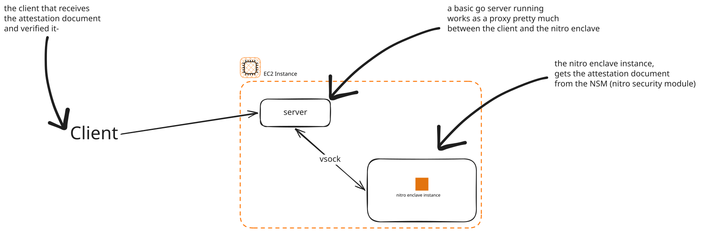

# AWS Nitro Attestation Verifier (Python)

Reference implementation of a basic AWS Nitro Enclaves remote attestation
workflow in Python. This is a port of the original Go reference implementation.

This project shows how to:

- accept a request from an external client
- relay that request through a parent EC2 instance
- ask a real Nitro Enclave for a fresh attestation document through vsock
- return that document to the client
- verify the AWS certificate chain, COSE signature, nonce, and PCR values on
  the client side



## What This Implements

The repository keeps the same three runtime pieces as the Go original, mapped
onto one Python package (`src/nitro_attestation`) with three entry points:

| Runtime piece            | Python module                  | Console script  | Go original                          |
| ------------------------ | ------------------------------ | --------------- | ------------------------------------ |
| Client verifier          | `nitro_attestation.client`     | `nitro-client`  | `client/cmd/request`                 |
| EC2 HTTP relay           | `nitro_attestation.relay`      | `nitro-relay`   | `ec2/cmd/server`                     |
| In-enclave NSM server    | `nitro_attestation.enclave`    | `nitro-enclave` | `nitro-enclave/cmd/attestation`      |
| Attestation verification | `nitro_attestation.verify`     | -               | `client/internal/attestation`        |

Supporting modules:

- `nitro_attestation.vsock` - vsock dial/listen helpers (Linux only), the
  Python equivalent of the `vsock_linux.go` / `vsock_unsupported.go` build tags.
- `nitro_attestation.nsm` - NSM attestation document generation via the AWS
  `libnsm` shared library, with a fallback that errors clearly off-enclave.

The deployed request path is:

```text
client -> EC2 HTTP relay -> vsock -> Nitro Enclave -> NSM attestation document
```

## Tech Used

- Python for the client, EC2 relay, and enclave application
- `cryptography` for X.509 chain and ECDSA signature verification
- `cbor2` for the CBOR / COSE_Sign1 attestation document format
- AWS `libnsm` (via `ctypes`) for enclave attestation document generation
- AWS Nitro Enclaves for enclave isolation and attestation
- VSock for parent-instance to enclave communication
- Terraform for the EC2 host and supporting AWS infrastructure
- `uv` for reproducible Python tooling and runs

## Repository Status

This is a focused reference implementation for understanding and testing the
attestation flow end to end. It is not a production confidential computing
platform, secret provisioning system, or complete Nitro Enclaves abstraction.

## Quick Start

Set up the local toolchain:

```sh
uv sync
uv run ruff check .
uv run pytest
```

Deploy the parent EC2 host with SSH enabled:

```sh
MY_IP=$(curl -fsSL https://checkip.amazonaws.com | tr -d '\n')
make infra-deploy ARGS="\
  -var='use_spot=false' \
  -var='instance_type=c6g.large' \
  -var='ssh_key_name=your-ec2-key-pair-name' \
  -var=\"allowed_ssh_cidr_blocks=[\\\"${MY_IP}/32\\\"]\""
```

Deploy the pushed `main` branch onto the parent EC2 host:

```sh
EC2_SSH_KEY_PATH=~/.ssh/your-key.pem make ec2-app-deploy
```

For local uncommitted work, sync the current working tree instead:

```sh
EC2_SSH_KEY_PATH=~/.ssh/your-key.pem make ec2-app-sync-deploy
```

Run the client verifier:

```sh
make nitro-root-cert
EC2_ATTESTATION_URL=$(make -s infra-urls | head -n1) \
AWS_NITRO_ROOT_CERT=.cache/aws-nitro-root/AWS_NitroEnclaves_Root-G1.pem \
uv run nitro-client
```

Destroy the infrastructure when finished:

```sh
make infra-destroy
```

## References

- [AWS Nitro Enclaves documentation](https://docs.aws.amazon.com/enclaves/latest/user/nitro-enclave.html)
- [AWS sample attestation repository](https://github.com/aws-samples/sample-nitro-enclaves-attestation)
- [aws-nitro-enclaves-nsm-api (libnsm)](https://github.com/aws/aws-nitro-enclaves-nsm-api)
- [vsock(7)](https://man7.org/linux/man-pages/man7/vsock.7.html)
