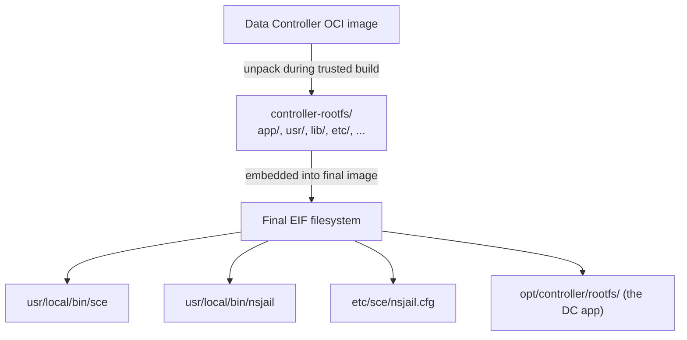

# CSAV

Consent Specification and Algorithm Verification. Runs as an EC2 instance.

Diagrams: [Figma design](https://www.figma.com/design/6l8ibdvznuSH79Aq0HsTOL/GDPR-Research?node-id=0-1&t=d3eVEK5dE1mpFEKO-1)

## What it does

Handles verification of algorithms and consent management. Maintains the Registry Service for build artifacts. Manages the mapping of `AlgorithmId` to the users it affects.

Consent/algorithm-compliance verification logic (checking creation is authorized before it happens) is future work, out of scope for now.

## Registry Service (part of CSAV)

Builds the EIF for Nitro Enclaves from a Data Controller's OCI image:

- **nsjail**: enforces the privilege boundary at runtime — the DC algorithm gets its rootfs, a `/data` scratch dir, the AF_UNIX gRPC socket sce-unit serves at `/data/sce.sock`, and a minimal `/dev` with `urandom` for gRPC entropy, nothing else.
- **Trust material**: public key pin or CA cert injected into the EIF at build time, so the enclave can verify the Verifier Service, Personal Data Management Service, KMS Service, and Log Service later.
- **Storage**: final EIF goes to S3, `AlgorithmId` -> S3 path goes to DynamoDB. Registry Service also generates PCR values and sends them to the Verifier Service.
- **KMS keys**: one PCR-bound key per algorithm, created on first build and reused on rebuild (its policy is rewritten to the new measurements), so a build never orphans the previous key. The policy grants `Decrypt` to the kms-service role under `kms:RecipientAttestation` conditions; the enclave and its host never decrypt directly.

## Design Decisions

- Registry Service (as part of CSAV) owns the build — DC only ever produces an OCI image, never the EIF, which is what makes attestation measurements meaningful.
- nsjail + image composition together are the privilege story: layout says where things live, nsjail says what they can do.
- The DC jail's seccomp policy is an **allowlist** (`DEFAULT KILL_PROCESS`), sized for the shipped samples: file I/O plus AF_UNIX sockets for the sce-unit gRPC channel, with no loopback interface. Resource limits (`rlimit_*`, `time_limit`) stay deliberately loose so large workloads are not capped by the jail config — further rlimit tightening is out of scope until measured per algorithm.
- `docker-compose.yml` and `csav-registry.service` live in this directory. `make deploy` runs `scripts/render_cfn.py` to bake them into EC2 UserData (no copies inside the CloudFormation template). `make ship` only pushes the image tarball + `.env`.
- Trust material baked in at build time, not configurable at runtime.
- TLS: public key pinning for the PoC; CA cert verification is a later step.
